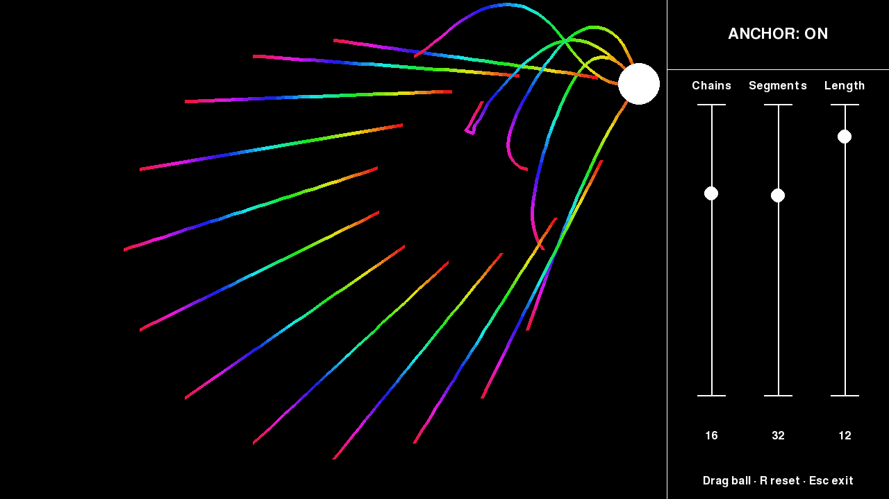
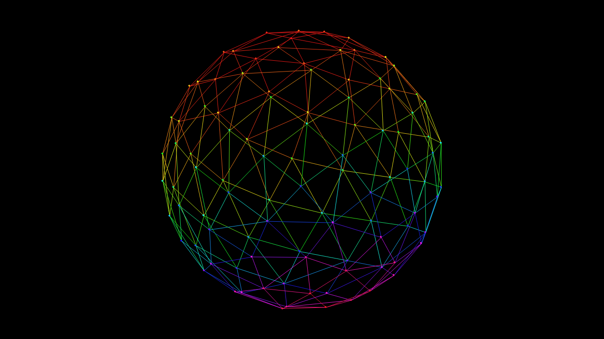
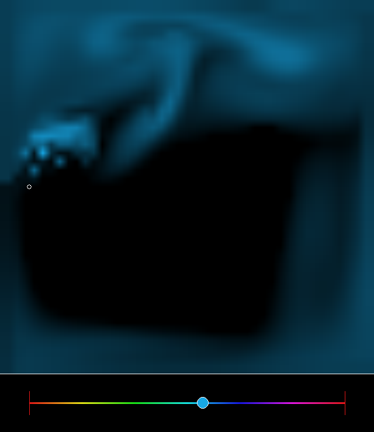

# Smaller projects

A few visual experiments in Python and Pygame.

| Demo | UI | Description |
| --- | --- | --- |
| [Inverse kinematics](inverse_kinematics.py) | Pygame | Rainbow chains following a draggable, bouncing ball |
| [Fibonacci sphere](fibonacci_sphere.py) | Pygame | Points distributed over a rotating sphere |
| [Turbulent flow](turbulent_flow.py) | Pygame | Interactive fluid simulation |

## Inverse kinematics



Requires Python 3.10+.

```sh
python3 -m venv .venv
source .venv/bin/activate
python -m pip install -r requirements.txt
python inverse_kinematics.py
```

On Windows, activate with `.venv\Scripts\activate`.

- Drag anywhere in the playfield to hold and move the ball; release to resume bouncing.
- Drag the three sliders to change chain count, segments per chain, and segment length.
- Click **ANCHOR** to pin roots to the circle or let the chains follow freely.
- **R** resets the ball and chains with the current settings. **Escape/F1** exits.

The default scene has 16 chains with 32 segments of length 12. Window and starting
values can be set from the command line:

```sh
python inverse_kinematics.py --size 1280 720 --chains 50 --segments 100 --length 10
python inverse_kinematics.py --fullscreen
```

### Performance

Inverse kinematics uses Pygame instead of Tkinter. The original follow-and-anchor
solver is batched across chains with NumPy, replacing repeated angle calculations
with vector normalization. Coincident joints keep their previous direction.
Anchors fit the playfield, sliders rebuild chains only when values change, and
static controls and text are cached. Simulation runs at 60 fixed steps per second.

For 50 chains × 100 segments, local solver time fell from about 5.2 ms to 0.89 ms.
The new update/draw path took about 2.8 ms, excluding display updates and the frame
cap. The original rainbow colors, black background, ball, and chain behavior remain.

```sh
python -m unittest discover -s tests -v
python tools/benchmark_ik.py --chains 50 --segments 100 --length 10
python tools/benchmark_ik.py --preview docs/inverse_kinematics.png
```

Tests and the benchmark run headlessly. Checks cover segment lengths, anchor and
target positions, coincident joints, ball bounds, dragging, sliders, and frame-rate
independence. The preview is rendered by the application.

## Fibonacci sphere



Use the same environment and dependencies as above:

```sh
python fibonacci_sphere.py
```

- **Left-drag:** rotate the sphere
- **Mouse wheel:** zoom, including trackpad scrolling
- **Ctrl or Space:** toggle automatic rotation
- **L:** show or hide connections
- **R:** reset the view; **Escape/F1:** quit

The default uses the original 100 points and connection distance. Larger scenes
keep connections local by scaling their distance with point density:

```sh
python fibonacci_sphere.py --points 1000
python fibonacci_sphere.py --fullscreen
python fibonacci_sphere.py --size 960 720
```

Connections and colors are cached once. Rotation and orthographic projection are
batched with NumPy, and each connection is drawn once with antialiasing. Idle
scenes redraw only when the view changes. The original black background and
rainbow palette remain.

For the 100-point scene, local geometry preparation fell from about 2.0 ms to
0.01 ms per frame, excluding drawing. The new complete software-render timing
is available with:

```sh
python tools/benchmark_sphere.py
python tools/benchmark_sphere.py --points 1000
python tools/benchmark_sphere.py --preview docs/fibonacci_sphere.png
```

These measurements exclude display updates and the frame cap. The shared test
suite checks the sphere geometry against the original calculations, plus drag,
zoom, rotation speed, and idle redraw behavior.

## Turbulent flow



```sh
python turbulent_flow.py
```

- **Left-click:** aim the emitter; **A** resumes its automatic sweep
- **Arrow keys:** move the emitter; hold **Shift** for larger steps
- **S:** stop/resume the emitter; **Space:** pause/resume the simulation
- **Right-drag:** paint and stir dye directly
- Drag the bottom rainbow slider to change color
- **B:** toggle smooth/blocky rendering; **R:** clear/reset; **Escape/F1:** quit

The default retains the 45×45 grid, black background, and colored dye. Smoother
scaling and brighter faint dye make the flow easier to see. For more grid detail:

```sh
python turbulent_flow.py --grid 90 --size 800
```

Simulation runs at 30 fixed steps per second. NumPy updates the grid in batches;
the pressure and diffusion equations use four neighbors for 2D, and advection
samples stay inside the grid. The solver uses 20 Jacobi passes instead of the
original four scalar relaxation passes. Local step time fell from about 15.9 ms
to 1.4 ms; texture drawing took about 0.17 ms, excluding display updates.

```sh
python tools/benchmark_flow.py
python tools/benchmark_flow.py --preview docs/turbulent_flow.png
```

The shared tests cover fluid boundaries, diffusion, pressure projection,
advection at extreme velocities, density fading, and the controls.
